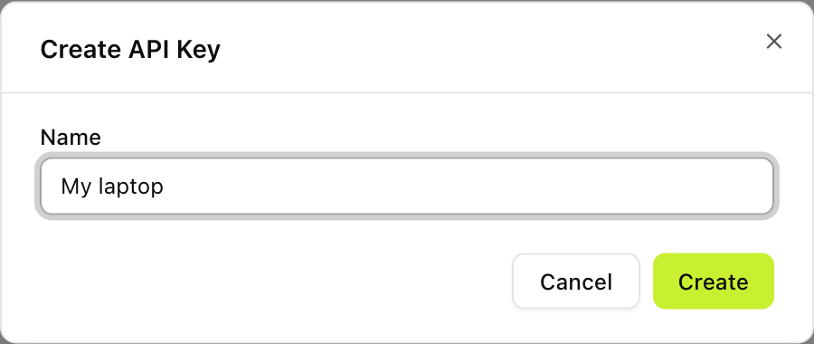
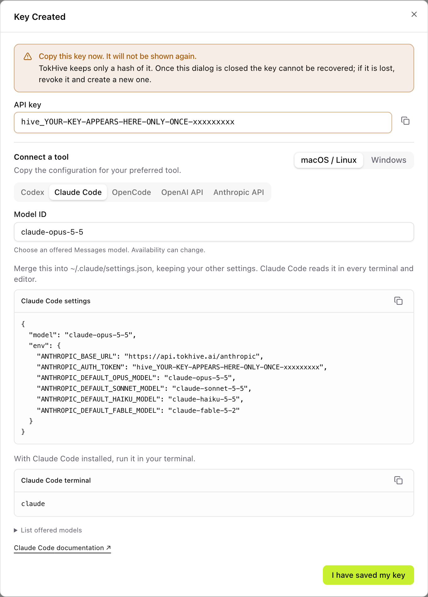

import Tabs from '@theme/Tabs';
import TabItem from '@theme/TabItem';

# Set Up Claude Code

This guide connects Anthropic's [Claude Code](https://code.claude.com/docs) to TokHive, so Claude Code runs on TokHive's models and draws on your TokHive balance. It takes about five minutes.

**You need:** a TokHive account with a balance above zero (see [Deposits](./deposits.mdx)), and a terminal on macOS, Linux or Windows.

## 1. Install Claude Code

Skip this step if `claude --version` already works.

<Tabs groupId="os">
<TabItem value="unix" label="macOS / Linux">

```sh
curl -fsSL https://claude.ai/install.sh | bash   # or: brew install --cask claude-code
```

</TabItem>
<TabItem value="windows" label="Windows (PowerShell)">

```powershell
irm https://claude.ai/install.ps1 | iex
```

</TabItem>
</Tabs>

You don't need to sign in to Claude Code with an Anthropic account to use TokHive.

## 2. Create an API key

In the [console](https://console.tokhive.ai), open **API Keys** and click **Create key**. Give it a name you will recognize, such as the machine it runs on, and click **Create**.



The key starts with `hive_` and is **shown only once**. Keep the dialog open and switch to the **Claude Code** tab: it shows the settings with your key and offered models already filled in.



Under **Model ID**, choose the model Claude Code should start with.

## 3. Add TokHive to the Claude Code settings

Claude Code reads its settings from a JSON file in your home folder, in every terminal and editor. Open it, creating it if it doesn't exist:

<Tabs groupId="os">
<TabItem value="unix" label="macOS / Linux">

`~/.claude/settings.json`

</TabItem>
<TabItem value="windows" label="Windows (PowerShell)">

`%USERPROFILE%\.claude\settings.json`

</TabItem>
</Tabs>

Paste the **Claude Code settings** block from the dialog. If the file already has settings, keep them: add `model` next to them and merge these entries into your existing `env` object.

```json
{
  "model": "claude-opus-5-5",
  "env": {
    "ANTHROPIC_BASE_URL": "https://api.tokhive.ai/anthropic",
    "ANTHROPIC_AUTH_TOKEN": "hive_xxxxxxxxxxxxxxxxxxxxxxxxxxxx",
    "ANTHROPIC_DEFAULT_OPUS_MODEL": "claude-opus-5-5",
    "ANTHROPIC_DEFAULT_SONNET_MODEL": "claude-sonnet-5-5",
    "ANTHROPIC_DEFAULT_HAIKU_MODEL": "claude-haiku-5-5",
    "ANTHROPIC_DEFAULT_FABLE_MODEL": "claude-fable-5-2"
  }
}
```

What the settings do:

- `ANTHROPIC_BASE_URL` and `ANTHROPIC_AUTH_TOKEN` send Claude Code's requests to TokHive with your key.
- `model` is the model new sessions start on.
- The four `ANTHROPIC_DEFAULT_*_MODEL` entries say which model each of Claude Code's `opus`, `sonnet`, `haiku` and `fable` aliases means. Claude Code uses them for subagents and background work as well as in `/model`, so each must name a model TokHive offers, or those requests fail with `model_not_found`. The dialog fills them in from the models offered right now.

The file is strict JSON: no comments, and no comma after the last entry.

## 4. Check that it works

Run a one-off request:

```sh
claude -p "Reply with exactly OK."
```

Claude Code should answer `OK`. Then open the console's **Call Records** page: the call is listed with its model, tokens and cost.

From now on, start Claude Code as usual with `claude`. Inside it, run `/status` to confirm that your user settings were loaded, and `/model` to switch models.

:::tip[Switch back to your Anthropic account]
Remove the TokHive entries from the `env` object, and the `model` line if you added it, then restart Claude Code. Your other settings stay as they were.
:::

## Troubleshooting

| What you see | What to do |
| --- | --- |
| `401` or `invalid_api_key` | Check the key in `ANTHROPIC_AUTH_TOKEN`. If it was revoked, create a new one and replace it. |
| `402` or `insufficient_balance` | Your balance is 0 or below. [Add funds](./deposits.mdx). |
| `model_not_found` | A model in the settings isn't offered, often one of the `ANTHROPIC_DEFAULT_*_MODEL` aliases. Point each at a model from the [price list](https://tokhive.ai/models/), or reopen **Setup guides** on the **API Keys** page to copy current values. |
| `503` or `no_supply` | No account can serve that model right now. Retry shortly, or switch to another model with `/model`. |
| Claude Code ignores the settings | Run `/status` and check that **User settings** is listed. A typo in the JSON makes Claude Code skip the file and report a settings error at startup. |

For every error code, see [Errors](../api/overview.mdx#errors).

Switching Claude Code between TokHive and another provider often? [CC Switch](./cc-switch.mdx) does it with one click.
