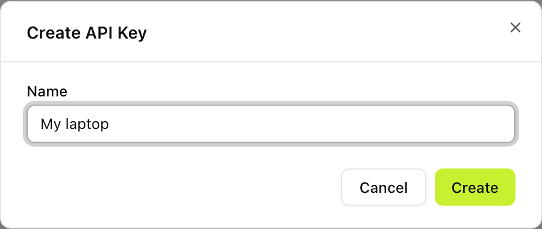
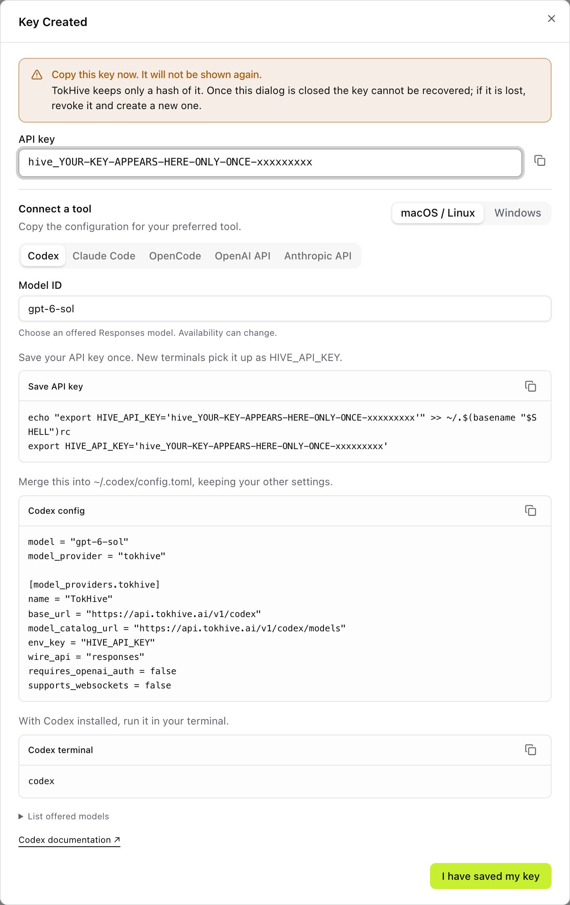

import Tabs from '@theme/Tabs';
import TabItem from '@theme/TabItem';

# Set Up Codex

This guide connects OpenAI's [Codex](https://developers.openai.com/codex/) CLI to TokHive, so Codex runs on TokHive's models and draws on your TokHive balance. It takes about five minutes.

**You need:** a TokHive account with a balance above zero (see [Deposits](./deposits.mdx)), and a terminal on macOS, Linux or Windows.

## 1. Install Codex

Skip this step if `codex --version` already works.

<Tabs groupId="os">
<TabItem value="unix" label="macOS / Linux">

```sh
npm install -g @openai/codex        # or: brew install --cask codex
```

</TabItem>
<TabItem value="windows" label="Windows (PowerShell)">

```powershell
npm install -g @openai/codex
```

</TabItem>
</Tabs>

You don't need to sign in to Codex with a ChatGPT account to use TokHive.

## 2. Create an API key

In the [console](https://console.tokhive.ai), open **API Keys** and click **Create key**. Give it a name you will recognize, such as the machine it runs on, and click **Create**.



The key starts with `hive_` and is **shown only once**. Keep the dialog open: it shows the setup for Codex with your key and an offered model already filled in.



Pick your operating system at the top right, keep the **Codex** tab, and choose a model under **Model ID**. The steps below match what the dialog shows.

## 3. Save the key

Codex reads the key from the `HIVE_API_KEY` environment variable. Save it once so every new terminal has it:

<Tabs groupId="os">
<TabItem value="unix" label="macOS / Linux">

```sh
echo "export HIVE_API_KEY='hive_xxxxxxxxxxxxxxxxxxxxxxxxxxxx'" >> ~/.$(basename "$SHELL")rc
export HIVE_API_KEY='hive_xxxxxxxxxxxxxxxxxxxxxxxxxxxx'
```

The first line adds the key to `~/.zshrc` or `~/.bashrc`; the second sets it in the terminal you are using now.

</TabItem>
<TabItem value="windows" label="Windows (PowerShell)">

```powershell
[Environment]::SetEnvironmentVariable("HIVE_API_KEY", 'hive_xxxxxxxxxxxxxxxxxxxxxxxxxxxx', "User")
$env:HIVE_API_KEY = 'hive_xxxxxxxxxxxxxxxxxxxxxxxxxxxx'
```

The first line saves the key for your Windows user; the second sets it in the PowerShell window you are using now.

</TabItem>
</Tabs>

Use the **Save API key** block from the dialog, which already contains your key.

## 4. Add TokHive to the Codex config

Open the Codex config file, creating it if it doesn't exist:

<Tabs groupId="os">
<TabItem value="unix" label="macOS / Linux">

`~/.codex/config.toml`

</TabItem>
<TabItem value="windows" label="Windows (PowerShell)">

`%USERPROFILE%\.codex\config.toml`

</TabItem>
</Tabs>

Add the **Codex config** block from the dialog. If the file already has settings, keep them and add these lines; if it already sets `model` or `model_provider`, replace those two.

```toml
model = "gpt-6-sol"
model_provider = "tokhive"

[model_providers.tokhive]
name = "TokHive"
base_url = "https://api.tokhive.ai/v1/codex"
model_catalog_url = "https://api.tokhive.ai/v1/codex/models"
env_key = "HIVE_API_KEY"
wire_api = "responses"
requires_openai_auth = false
supports_websockets = false
```

What the settings do:

- `base_url` points Codex at TokHive's Codex endpoint, which passes Codex's requests through unchanged, so new Codex versions keep working.
- `model_catalog_url` lets Codex's `/model` picker list the models TokHive offers right now.
- `env_key` tells Codex to send the key from `HIVE_API_KEY`.
- `requires_openai_auth = false` stops Codex from asking you to sign in to OpenAI.

## 5. Check that it works

Run a one-off request:

```sh
codex exec "Reply with exactly OK."
```

Codex should answer `OK`. Then open the console's **Call Records** page: the call is listed with its model, tokens and cost.

From now on, start Codex as usual with `codex`. Inside Codex, `/model` switches between the models TokHive offers.

:::tip[Keep your ChatGPT login for other work]
To choose per session between TokHive and your own ChatGPT login, put TokHive in a profile instead of setting the top-level `model` and `model_provider`:

```toml
[profiles.tokhive]
model = "gpt-6-sol"
model_provider = "tokhive"
```

Keep the `[model_providers.tokhive]` block as above, and start Codex with `codex --profile tokhive` when you want TokHive.
:::

## Troubleshooting

| What you see | What to do |
| --- | --- |
| `401` or `invalid_api_key` | The terminal doesn't have the key. Open a new terminal after step 3, or check `echo $HIVE_API_KEY` (macOS / Linux) or `$env:HIVE_API_KEY` (Windows). If the key was revoked, create a new one. |
| `402` or `insufficient_balance` | Your balance is 0 or below. [Add funds](./deposits.mdx). |
| `model_not_found` | The model in `config.toml` isn't offered. Pick one from `/model` in Codex or from the [price list](https://tokhive.ai/models/). |
| `503` or `no_supply` | No account can serve that model right now. Retry shortly, or switch to another model. |
| Codex asks you to sign in | Check that `requires_openai_auth = false` is in the `[model_providers.tokhive]` block and that `model_provider = "tokhive"` is set. |

For every error code, see [Errors](../api/overview.mdx#errors).

Switching Codex between TokHive and another provider often? [CC Switch](./cc-switch.mdx) does it with one click.
