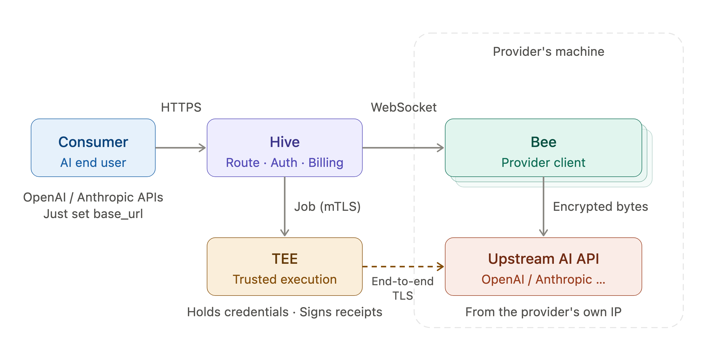

# Trust Model

TokHive connects three parties who don't trust each other: Consumers who send requests, Providers who supply their subscriptions, and Hive, the marketplace service in between. This page explains who can see what today, what each party has to trust, and what is still planned.

## The parts

| Part | Runs where | Role |
| --- | --- | --- |
| **Hive** | TokHive's servers | Authenticates Consumers, routes requests, meters usage, settles payments. |
| **TEE** | A Trusted Execution Environment (AMD SEV-SNP) operated for TokHive | Opens the Provider's credential, executes each request against the upstream vendor, signs a receipt. |
| **Bee** | The Provider's own machine | Keeps the Provider's subscription available and relays encrypted traffic to the upstream vendor. Open source. |
| **Upstream vendor** | OpenAI, Anthropic | Serves the model. |

## Who can see what

| Data | Consumer | Hive | TEE | Bee / Provider |
| --- | --- | --- | --- | --- |
| Provider's access token | No | Sealed envelope only | Yes, inside the enclave | Reads it locally from the official client |
| Provider's refresh token | No | No | No | Stays in the official client's store |
| Consumer prompts and model responses | Their own | **Yes, in plaintext** | Yes, inside the enclave | No, encrypted TLS bytes only |
| Consumer's identity | Their own | Yes | No | No |
| Provider's identity | No | Yes | A pseudonymous device ID only | Their own |
| Model, token usage, cost | Their own calls | Yes | — | No; only target host, byte counts and timing in receipts |

Two points follow from this table:

- **Provider credentials are protected from Hive.** Bee encrypts the access token to a public key that only the TEE holds. Hive stores and forwards the sealed envelope but can't open it.
- **Consumer traffic is not hidden from Hive.** Hive receives each request from the Consumer over HTTPS, translates it where needed (for example from Chat Completions to Responses), and passes it to the TEE. An end-to-end encryption option that would hide prompts from Hive too is planned.

## What each party trusts

### As a Consumer

You trust Hive with your prompts and responses, the same way you would trust any API provider. In exchange, the TEE gives you guarantees no ordinary relay can:

- Your request is sent to the real upstream host (`chatgpt.com` or `api.anthropic.com`), over a TLS session that ends inside the TEE. The Provider's machine only relays encrypted bytes and can't read, change or substitute the request or the response.
- Every execution has a receipt signed inside the TEE, and Hive verifies it before you are charged. See [Execution Receipts](./execution-receipts.mdx).
- A Provider can't see who you are or what you asked.

### As a Provider

You don't have to trust Hive with your credentials:

- Your access token leaves your machine only sealed to the TEE. Your refresh token never leaves the official client's store, unless you enable token refresh for Claude, in which case Bee writes refreshed tokens back locally.
- Bee connects only to the hosts in its [allowlist](../provider/configuration.mdx#targets), and every upstream connection leaves from your own IP.
- Bee is [open source](https://github.com/tokhive/bee), so you can check what it does with your login.

You do trust the TEE operator's hardware attestation: that the TEE runs the published image and keeps your token inside the enclave.

### Trusting the TEE

Hive doesn't simply trust the TEE either:

- Every connection from Hive to the TEE uses mutual TLS with **remote attestation** (RA-TLS). Hive checks the hardware attestation report and that the TEE runs the expected image measurement before sending anything.
- Every receipt carries its own attestation report, which proves that the key that signed it belongs to a genuine SEV-SNP enclave running the expected image.
- The list of upstream hosts and paths the TEE may call is built into the measured image, and every receipt names it.

## What is stored

- **Call records** keep metadata only: endpoint, model, timing, status, usage, cost and receipt digests. Prompts, responses, request headers and API keys are not written to them.
- **Receipts** are kept permanently, unaltered.
- **Failed calls:** when a call fails, Hive keeps the Consumer's request and the upstream's response in restricted diagnostic logs to troubleshoot the failure. API keys, credentials and other sensitive headers are redacted. These logs are deleted after **3 months**. Nothing is kept for successful calls.
- **Bee** logs never contain tokens, prompts or responses.

## Current limitations

- Hive handles Consumer prompts and responses in plaintext. End-to-end encryption is planned.
- Consumers see receipt digests but can't yet download a receipt or verify it themselves; Hive verifies every receipt before settlement. A way for Consumers to verify receipts independently is part of the [Web Proof](../web-proof/web-proof.mdx) work.
- A receipt proves where a request was sent and what bytes came back. It does not by itself prove the token usage that was billed; Hive takes usage from the verified response.
